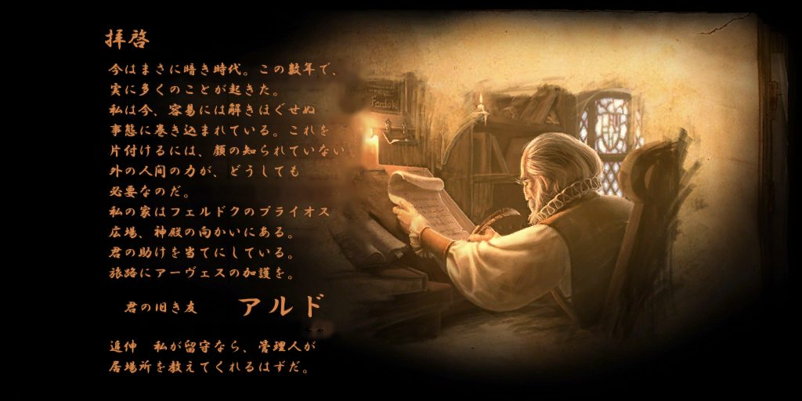

# Drakensang: The Dark Eye 日本語化パッチ

Steam 版（英語版）の **Drakensang: The Dark Eye** を日本語で遊べるようにする、非公式のパッチです。
会話・クエスト日誌・アイテムやスキルの説明・UI の文章をすべて訳し、メインメニュー、冒頭の手紙、地図、看板や碑文の画像も日本語に描き直しています。

- 紹介ページ: https://higesho.github.io/drakensang-jp/
- ダウンロード: [Releases（最新版）](https://github.com/higesho/drakensang-jp/releases/latest)

## 対象

Steam 版 Drakensang: The Dark Eye（英語版、バージョン 1.03）

## 導入方法

1. [Releases](https://github.com/higesho/drakensang-jp/releases/latest) から `Drakensang_JP_Patch_v○○.zip` をダウンロードし、展開します。
2. ゲームを終了しておきます。
3. ゲームのフォルダ（`drakensang.exe` があるフォルダ）を開きます。
   Steam のライブラリで Drakensang を右クリック →「管理」→「ローカルファイルを閲覧」
4. 展開したフォルダの中の `export` フォルダを、ゲームのフォルダにコピーします。「置き換える」を選びます。

上書きされるのは `export\db\locale.db4` と `export\data\fonts\Drakensang` の2つだけで、残りは追加されるファイルです。
上書き前にこの2つを控えておくと、すぐに元に戻せます。

## 元に戻す

1. ゲームのフォルダの `export\textures` フォルダを削除します。
2. Steam の「ゲームファイルの整合性を確認」を実行します（テキストとフォントが英語版に戻ります）。

## 注意点

- キャラクター名は英字で入力してください。日本語入力（IME）がオンのまま名前欄に文字を打つと、ゲームがエラーで止まります。
- 環境によっては、フルスクリーン起動直後に `GetBackBuffer() on device failed` で止まることがあります（日本語化とは無関係）。
  起動オプションに `-windowed -w 1600 -h 900` を入れるとウィンドウモードで起動できます。
- 翻訳は AI（Claude）による機械翻訳です。誤訳や不自然な表現を見つけたら [Issues](https://github.com/higesho/drakensang-jp/issues) で教えてください。

## フォントと謝辞

- 日本語フォントは [Noto Sans JP](https://fonts.google.com/noto/specimen/Noto+Sans+JP)（© 2014-2021 Adobe）を改変したもので、SIL Open Font License 1.1 に従って同梱しています（zip 内の `OFL.txt`）。
- 日本語化の方法は [Drakensang:The Dark Eye 情報まとめ wiki](http://drakensang.gamedb.info/wiki/) の「日本語化/日本語表示について」を参考にしました。

このパッチは非公式のファン製作物です。使用は自己責任でお願いします。
Drakensang: The Dark Eye およびゲーム内の文章・画像の著作権は、各権利者に帰属します。
